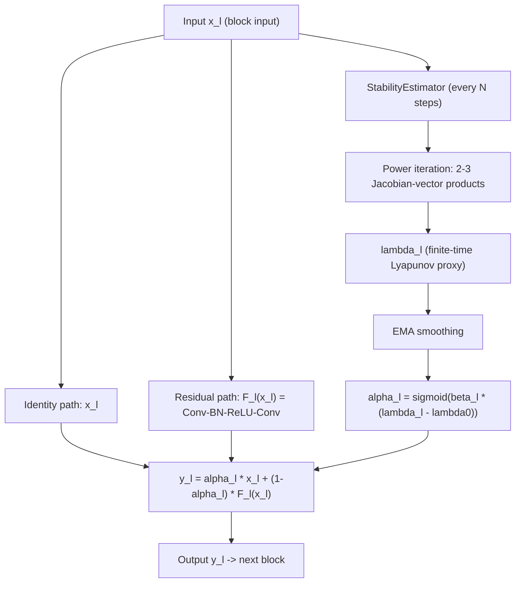

# LyASC — Architecture Document

**Status: design specification, not yet implemented or trained.** Every
number in this document that is not explicitly labeled "verified base_model
result" is a design target or open question, not a measured outcome. No
LyASC training run has occurred at the time of writing. This document
exists to fully specify the architecture before any code is written, per
the same "characterize before touching code" discipline used throughout
the base-model reproduction.

---

## 1. Purpose and Core Idea

LyASC (Lyapunov-Aware Skip Connections) replaces a residual block's fixed
skip-connection weighting with a per-block gate driven by an online,
cheap estimate of local dynamical instability, rather than by a fixed
scalar (as in the base paper's `xSkip`/`rSkip` family) or an unconstrained
learned parameter (as in the base paper's `wSkip`).

General base-paper form (verified, reproduced, `plan.md` Section 4.2):
```
y = G(λx + F(x, W))
```

LyASC's form:
```
α_l = σ(β_l · (λ_l − λ0))
y_l = α_l · x_l + (1 − α_l) · F_l(x_l)
```
where `λ_l` is a finite-time-Lyapunov-style local instability proxy for
block `l`, `λ0` is a stability threshold hyperparameter, `β_l` is a
per-block learnable sensitivity scalar, and `σ` is the sigmoid function.
This is architecturally closest to the base paper's `wSkip+LN` family
(a per-block modulation of the skip/residual balance) but replaces the
free, unconstrained gate value with one derived from a measured signal.

---

## 2. The Stability Signal — Exact Specification

### 2.1 What is measured
For residual branch `F_l` with input `x_l`, local stability is governed by
the local Jacobian `J_l(x_l) = ∂F_l/∂x_l`. If the dominant singular value of
`J_l` exceeds 1, small perturbations are locally amplified (unstable); if
below 1, they are damped (stable).

### 2.2 Estimation algorithm
Full Jacobian computation is prohibitively expensive; the dominant singular
value is estimated via power iteration using Jacobian-vector products
(forward-mode) or vector-Jacobian products (reverse-mode autodiff), both
natively supported by PyTorch autograd:

```
1. Sample a random unit vector v in the input space of block l.
2. Compute u = J_l · v via a Jacobian-vector product (no explicit Jacobian formed).
3. Normalize: v ← u / ||u||.
4. Repeat steps 2-3 for k iterations (k = 1-3).
5. λ_l ≈ log(||u||)  — the finite-time Lyapunov proxy for this block.
6. Smooth λ_l over training via an exponential moving average to reduce
   mini-batch stochasticity.
```

### 2.3 Recompute schedule
The estimate is refreshed every `N` training steps (not every step) to
control overhead. Between refreshes, the gate uses the last smoothed value.
`k` and `N` are open hyperparameters — see Section 8.

### 2.4 Compute overhead
With `k=2`, `N=10`: approximately `(k/N) ≈ 20%` of one extra forward/backward
pass through the affected block per estimator refresh, amortized to roughly
2% overall training-time overhead. **This must be measured empirically on
first implementation, not assumed** — report actual wall-clock overhead
alongside the first Table-1-equivalent run.

---

## 3. Module-Level Architecture (integration with base_model code)

LyASC does not require a new backbone or a new training loop. It requires
exactly two new modules, following the interface conventions already
established and load-bearing throughout `base_model/src/models/skip_variants.py`.

### 3.1 `StabilityEstimator` (new module, `lyasc_model/src/models/stability_estimator.py`)
```
class StabilityEstimator(nn.Module):
    def __init__(self, k: int = 2, N: int = 10, ema_decay: float = 0.9):
        ...
    def forward(self, F_l: Callable, x_l: torch.Tensor, step: int) -> torch.Tensor:
        """Returns the current smoothed lambda_l estimate for this block.
        Recomputes via power iteration only when step % N == 0; otherwise
        returns the cached EMA value."""
```
Owns: the random probe vector state (persisted across calls for power
iteration continuity), the EMA buffer, and the step counter.

### 3.2 `LyASCSkip` (new module, `lyasc_model/src/models/lyasc_skip.py`)
```
class LyASCSkip(nn.Module):
    """y = alpha_l * x + (1 - alpha_l) * F_x, with alpha_l = sigmoid(beta_l * (lambda_l - lambda0))"""
    def __init__(self, channels: int, lambda0: float = 0.0, estimator: StabilityEstimator = None):
        super().__init__()
        self.beta_l = nn.Parameter(torch.zeros(1))   # init 0 -> alpha starts at sigmoid(0)=0.5
        self.lambda0 = lambda0
        self.estimator = estimator

    def forward(self, x: torch.Tensor, F_x: torch.Tensor) -> torch.Tensor:
        lam = self.estimator.current_value()   # cheap read, no recompute here
        alpha = torch.sigmoid(self.beta_l * (lam - self.lambda0))
        return alpha * x + (1 - alpha) * F_x
```
This satisfies the exact `forward(self, x, F_x) -> torch.Tensor` contract
every other class in `skip_variants.py` already implements, so
`preact_resnet.py`'s `PreActBasicBlock` requires **zero changes** to accept
it — it is passed in as `skip_variant` exactly like `PlainSkip`,
`ExpandedSkipLN`, etc.

### 3.3 Where the estimator actually runs
The expensive power-iteration step (Section 2.2) must run once per block
per refresh cycle, which means it needs access to `F_l` and `x_l` at the
point of the forward pass — this requires a small, explicit hook in
`PreActBasicBlock.forward()` or in the training loop itself (calling
`estimator.forward(...)` before `skip_variant(...)` is invoked), not inside
`LyASCSkip.forward()` — a design decision to keep `LyASCSkip` a cheap,
side-effect-free read and keep the expensive computation clearly separated.
**This integration point is a genuine open implementation decision** (see
Section 8) — decide and document it before writing `train.py` integration
code, following the same "log every architectural decision" discipline as
`base_model/results/logs/decisions.log`.

### 3.4 Reused, unchanged from base_model
- `src/models/preact_resnet.py` — backbone, downsampling shortcut policy
  (Option A, zero-pad), block structure. No changes.
- `src/training/train.py` — training loop, gradient clipping
  (`max_norm=5.0`), weight-decay exclusion logic (extend the `.w`-style
  name-based exclusion to also exclude `.beta_l`, since it is a gain-like
  gate parameter, not a transformation weight — apply the same reasoning
  already validated for `LearnableVectorSkip.w`).
- `src/training/config.py` — config schema, extended with new fields for
  `k`, `N`, `ema_decay`, `lambda0`.
- `src/utils/seed.py`, `src/utils/logging_utils.py` — unchanged.

---

## 4. Data Flow (per training step, per LyASC block)



---

## 5. Baseline Comparison Family (all verified, from `base_model` — reused, not retrained)

| Baseline | Role | Verified result (base_model, ±0.4pp rule) |
|---|---|---|
| `1xSkip` | Floor: no adaptivity, no normalization | PASS, 6.27% (Table 1) |
| `rSkip+LN` (λ=2) | Best fixed schedule to match or beat | PASS, 6.15% (Table 1) |
| `wSkip+LN` | Direct "unconstrained learned gate" competitor | FAIL vs. paper (8.16% vs. 8.66%), required 2 mitigation attempts to stabilize, still underperformed |
| `1xSkip+BN`/BN family | Normalization-pairing reference | FAIL vs. paper (outperform), consistently below LN-paired numbers |
| `LN(0.5x+F)`, `LN(x+2F)`, `LN(x+3F)` | Catastrophic/bimodal stress cases | FAIL, reproduced paper's own catastrophic characterization; `LN(x+2F)` genuinely bimodal across seeds |
| Table 6 (CIFAR-100, depths 20-110) | Depth-scaling reference | 2rSkip+LN advantage over baseline holds at every depth |

LyASC experiments report against these exact numbers — do not retrain any
of these baselines; they are already complete, tested, and archived in
`base_model/results/`.

---

## 6. Cold-Start Handling (required, not optional)

Every LN-augmented base_model variant showed a large transient gradient
spike (grad_norm in the hundreds to low thousands) in the first ~1000
iterations, self-healing by ~2000 for stable variants but permanently
fatal for the catastrophic Table 3 rows. LyASC's estimator will see this
same transient during the identical cold-start window. Two candidate
handling strategies, **neither validated yet — this is an open
experimental question, not a settled decision**:
- **(A) Warm-up**: hold `alpha_l` at a fixed default (e.g. 0.5) for the
  first ~1000-2000 iterations, ignoring the estimator entirely, before
  switching to the Lyapunov-driven gate.
- **(B) Damped early influence**: let the estimator run from iteration 0,
  but scale its influence on `alpha_l` by a factor ramping from 0 to 1
  over the same window.

Gradient clipping (`max_norm=5.0`) is adopted unconditionally regardless
of which strategy is chosen, per the base-model precedent.

---

## 7. Normalization Pairing

LyASC's default block does not include a `G()` normalization step — the
gate directly blends `x` and `F(x)`. Whether to add an LN or BN step after
the blend (matching the base paper's general form) is an explicit ablation,
not assumed:
- **Default**: no explicit `G()`, gate output feeds directly to the next
  block (relies on the backbone's existing BN layers inside `F_l`).
- **Ablation 1**: `G()` = LayerNorm2d (reuse `base_model`'s validated
  channel-wise implementation), given LN measurably outperforms BN as a
  skip-pairing normalization in every verified base_model comparison.
- **Ablation 2**: `G()` = BatchNorm2d, included specifically to test
  whether a stability-aware gate narrows the BN-vs-LN gap observed in
  Table 4.

---

## 8. Open Design Questions (explicitly unresolved — do not assume answers)

1. Where exactly does the expensive power-iteration call live in the
   forward pass (Section 3.3)? This affects both correctness and speed.
2. What values of `k` (power-iteration steps) and `N` (recompute interval)
   give an acceptable overhead/accuracy tradeoff? Must be measured, not
   guessed — start with `k=2, N=10` as a documented starting point only.
3. Cold-start strategy A vs. B (Section 6) — untested.
4. Initialization of `beta_l`: starting at 0 (giving `alpha_l = 0.5`
   uniformly at init) is the current default — untested against
   alternatives (e.g., initializing near 1 to start closer to a pure
   identity shortcut, mirroring `wSkip+LN`'s `w=1` init).
5. Whether `beta_l` should be excluded from weight decay (very likely yes,
   by direct analogy to `LearnableVectorSkip.w`'s validated exclusion, but
   this should be explicitly decided and logged, not assumed by default).
6. Downsampling-block behavior: the base_model's `IdentityZeroPadShortcut`
   means some skip-path channels are structurally zero at downsampling
   blocks (documented, benign, in `decisions.log`). LyASC's estimator
   needs an explicit decision on whether/how it computes `lambda_l` at
   these blocks, since the Jacobian of a zero-padded, strided identity is
   degenerate in the padded channels.

Every one of these must be resolved via the same debugging discipline used
throughout the base-model reproduction: characterize, validate cheaply on
a single seed before a full batch, log the decision with rationale in
`lyasc_model/results/logs/decisions.log`, cap investigation at 3 attempts
per open question before flagging for review.
